<div align="center">

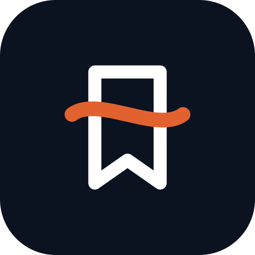

# SaveSutra

**Everything you save, finally makes sense.**

Share any reel, YouTube video, article, tweet, LinkedIn post, AI tool, recipe or screenshot to SaveSutra. It reads the whole thing (caption, audio and on-screen text), files it by topic and date, pulls out the **tools, places, links, prices and steps** inside, and lets you find it again in seconds: in the app or on WhatsApp.

[**⬇ Download the Android APK**](https://github.com/GOD-MANAV/savesutra/releases/latest/download/SaveSutra.apk) · [**▶ Try the web demo**](https://god-manav.github.io/savesutra/app/) · [**🌐 Website**](https://god-manav.github.io/savesutra/) · [**🎨 Design (Claude Design)**](https://claude.ai/artifact/2Lgu3EdgL195GhbFWUazHm)

[](https://github.com/GOD-MANAV/savesutra/actions/workflows/ci.yml)
[](https://github.com/GOD-MANAV/savesutra/actions/workflows/android.yml)
[](LICENSE)

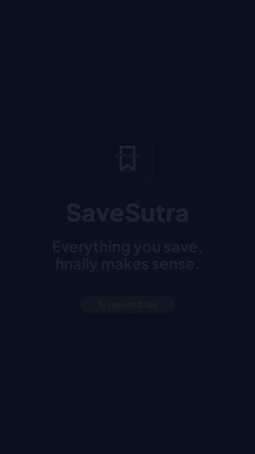

<sub>Full-quality promo video: [apps/site/public/promo.mp4](apps/site/public/promo.mp4)</sub>

</div>

---

## The problem

I used to send every interesting reel, video and link to my mom's WhatsApp "for safekeeping". After a few hundred links, that chat became a graveyard: no titles, no context, no way to search. *Which one was the AI tool for slides? Where was that café?*

Everyone does a version of this: Instagram "Saved", WhatsApp-to-self, screenshots, open tabs. Saving is easy. **Finding and using** what you saved is the hard part. ([Full PRD →](docs/PRD.md))

## What SaveSutra does

| | |
|---|---|
| **Save from anywhere** | Android share sheet, paste a link, forward it to the **WhatsApp bot**, or **import an exported WhatsApp chat** (every old link keeps its original date). |
| **Understands any content** | Reels, Shorts, YouTube, X threads, LinkedIn posts, articles, blogs, screenshots, any web page. |
| **Deep extraction** | Summary, key points, category and tags, plus every **tool, place, product, book, price, ingredient and step**, including links *said in the audio* or *shown on screen*. |
| **Smart collections** | "All AI tools I've saved", "Places", "Books", "Recipes", "Links found inside". They build themselves. |
| **Four layouts** | **Cards** (by day) · numbered **Table** with Excel/CSV export · **Board** (whiteboard) · **Timeline** with a saves heatmap. |
| **Search like you remember** | Typo-tolerant ranked search across titles, notes, tools and places, with filters: `cat:ai`, `from:youtube`, `#goa`. |
| **Resurfacing** | Weekly digest, "On this day", and *To try / Done / Pinned* status so good saves don't die. |
| **Private by design** | Offline-first (IndexedDB), consent-first onboarding, export and delete everything, AI output always labelled. |

## Screens

<table>
<tr>
<td>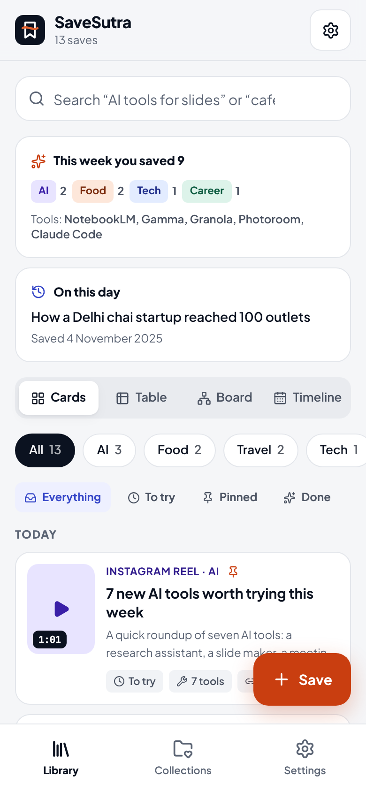</td>
<td>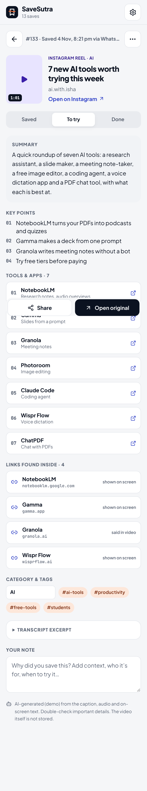</td>
<td>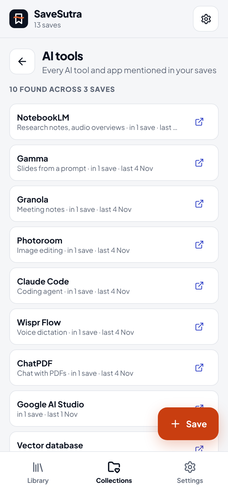</td>
<td>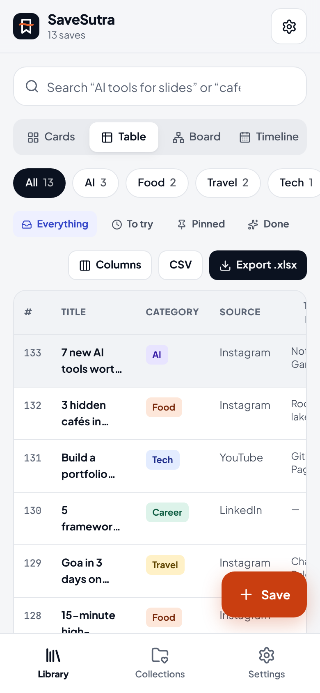</td>
</tr>
<tr>
<td align="center">Library + weekly digest</td><td align="center">Deep extraction</td><td align="center">Every AI tool you saved</td><td align="center">Table + Excel export</td>
</tr>
<tr>
<td>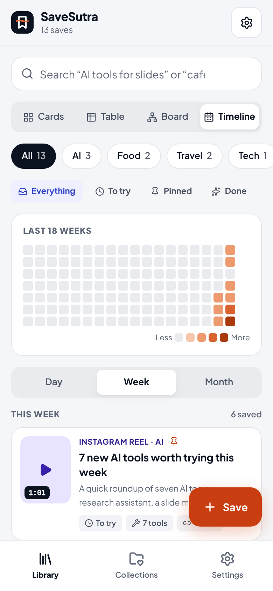</td>
<td>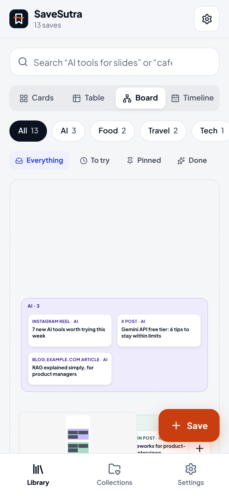</td>
<td>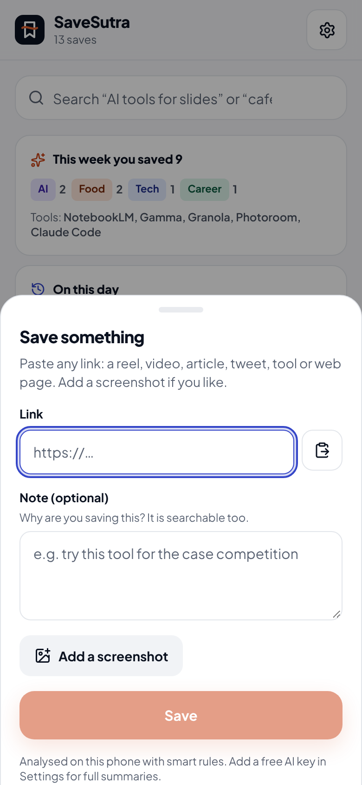</td>
<td>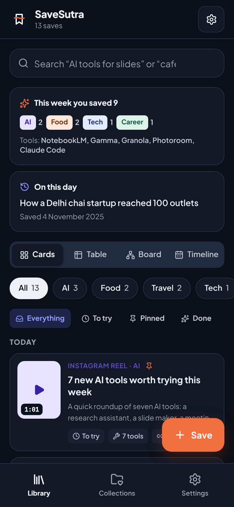</td>
</tr>
<tr>
<td align="center">Timeline + heatmap</td><td align="center">Whiteboard</td><td align="center">Save anything</td><td align="center">Dark mode</td>
</tr>
</table>

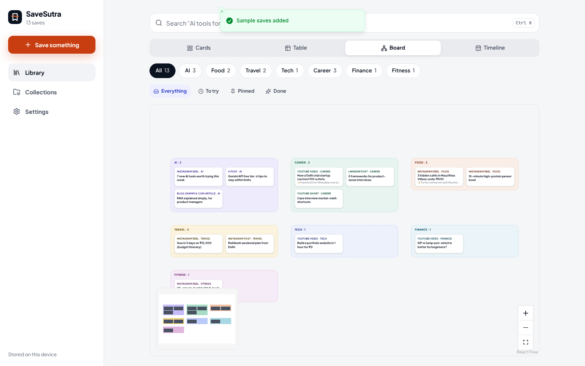

## How it works

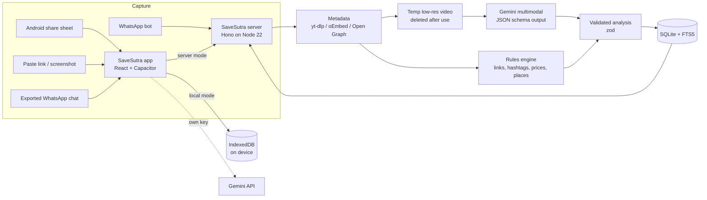

1. **Normalise** the link (strip `igsh`, `utm_*`, `si`…; `youtu.be` → canonical), so duplicates collapse.
2. **Fetch public metadata**: yt-dlp for video platforms, oEmbed for YouTube, Open Graph for everything else. SSRF-guarded (every redirect hop is DNS-checked against private ranges).
3. **Analyse**: Gemini reads the video (YouTube straight from its URL; others from a temporary ≤ 4-minute low-res copy that is deleted right after) and returns JSON that matches a strict schema. No key? A rules engine still extracts links, hashtags, prices, places, list items and a category (Hinglish keywords included).
4. **Validate & merge**: model output is parsed with zod, links normalised and de-duplicated, and rule-found caption links are merged in so nothing is lost.
5. **Index**: SQLite FTS5 (BM25 weighted towards title and tags) on the server; a typo-tolerant ranked search on the device.

More: [Architecture](docs/ARCHITECTURE.md) · [Compliance & privacy](docs/COMPLIANCE.md) · [Security](SECURITY.md)

## Tech stack

| Layer | Choice | Why |
|---|---|---|
| App | React 19, TypeScript, Vite, Tailwind CSS v4 | Fast, typed, small |
| UI kit | Radix primitives (shadcn/ui style), vaul bottom sheets, sonner toasts, lucide icons | Accessible by default |
| Views | TanStack Table (table), **React Flow** (board, MIT), custom heatmap | tldraw's SDK needs a paid production licence; React Flow is MIT |
| Storage | Dexie (IndexedDB) on device · Node's built-in `node:sqlite` + FTS5 on server | No native builds |
| Android | Capacitor 8 + `@capgo/capacitor-share-target`, native HTTP | Real share-sheet target, no CORS limits |
| Server | Hono on Node 22, `tsx` | Tiny, fast, typed |
| AI | Google Gemini (`gemini-flash-latest`), JSON-schema output | Native video understanding; free tier |
| Media | yt-dlp, ffmpeg | Public metadata and short temp copies only |
| Export | write-excel-file, RFC 4180 CSV with formula-injection guard | Opens cleanly in Excel |
| Quality | Vitest (33 tests across core, server and app), GitHub Actions CI | |
| Design | Claude Design canvas → code | [View the canvas](https://claude.ai/artifact/2Lgu3EdgL195GhbFWUazHm) |

## Repository layout

```
packages/core   Shared domain logic: URL normalisation, extraction rules, AI prompt + schema,
                search, smart collections, timeline, WhatsApp-chat import, bot commands
apps/web        The app (PWA). Same build is packaged as the Android APK with Capacitor
apps/server     API, analysis pipeline, SQLite FTS5 search, WhatsApp Cloud API webhook
apps/site       Landing website + privacy notice (GitHub Pages)
docs/           PRD, architecture, compliance, deploy, WhatsApp and Android guides
```

## Run it

```bash
git clone https://github.com/GOD-MANAV/savesutra && cd savesutra
npm install
npm run dev:web          # app on http://localhost:5173 (works fully offline in local mode)
npm test                 # core + server + app tests
```

Server (optional: needed for the WhatsApp bot and deep video analysis of Instagram/X):

```bash
cp apps/server/.env.example apps/server/.env    # set API_TOKEN, GEMINI_API_KEY
npm run dev:server                              # http://localhost:8787/api/health
# or: docker build -f apps/server/Dockerfile -t savesutra . && docker run -p 8787:8787 --env-file apps/server/.env savesutra
```

Guides: [Deploy the server](docs/DEPLOY.md) · [Set up the WhatsApp bot](docs/WHATSAPP_SETUP.md) · [Build the APK](docs/ANDROID.md)

## Install the Android app

1. On your phone, open **[SaveSutra.apk](https://github.com/GOD-MANAV/savesutra/releases/latest/download/SaveSutra.apk)** (built automatically by GitHub Actions on every push).
2. Allow **Install unknown apps** for your browser when Android asks.
3. In Instagram, YouTube, Chrome or WhatsApp tap **Share → SaveSutra**.

## Responsible by design

- **India DPDP Act 2023 / DPDP Rules 2025**: plain-language notice before consent, consent you can withdraw as easily as you gave it, data export and erasure, grievance route. ([details](docs/COMPLIANCE.md))
- **WhatsApp Business Platform rules (15 Jan 2026)**: the bot is purpose-specific (save and search only) and declines open-ended chat. It replies only inside the user-initiated service window, and supports `stop`.
- **Creators & platforms**: notes and links, not copies. Public content only: no logins, no cookies, no private accounts. Media is deleted after analysis.
- **AI transparency**: every summary is labelled as AI or rules output, with the model name.
- **Security**: SSRF protection, HMAC-verified webhooks, timing-safe tokens, rate limits, strict CSP, prompt-injection-aware system prompt. ([SECURITY.md](SECURITY.md))

## Roadmap

- [ ] iOS share extension
- [ ] Semantic (embedding) search alongside FTS
- [ ] Shared collections with family ("Maa's recipes")
- [ ] Reminders for *To try* saves
- [ ] Hindi UI

## About

Built by **Manav Yadav** (MBA, DMS IIT Delhi · BTech Computer Engineering, DTU), with Claude Design for the UI and Claude Code for the build. Created for the Wispr Flow hiring challenge.

MIT licensed. SaveSutra is not affiliated with Instagram, YouTube, WhatsApp, Meta or Google.
