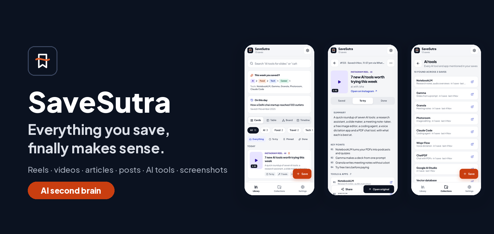
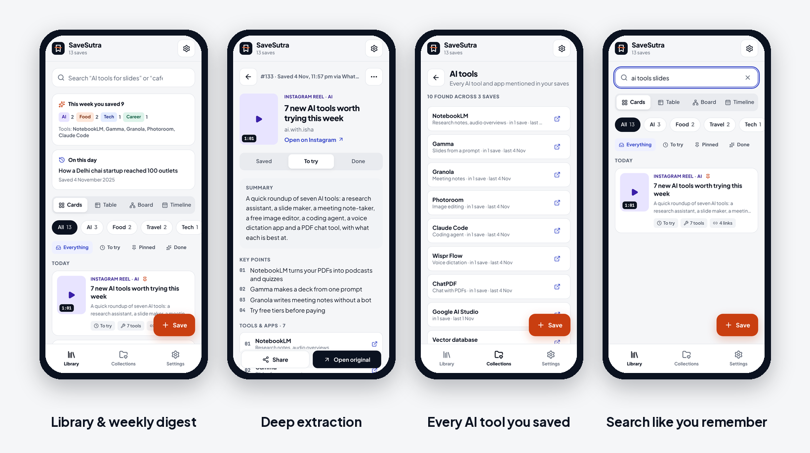
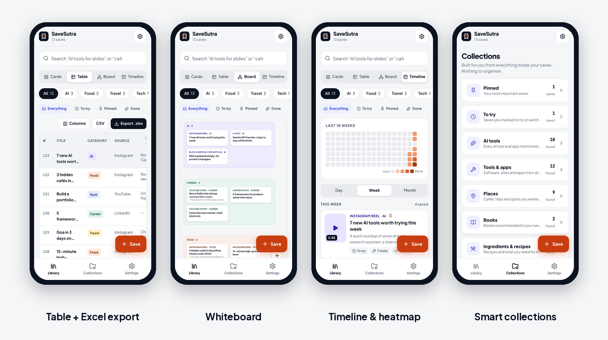
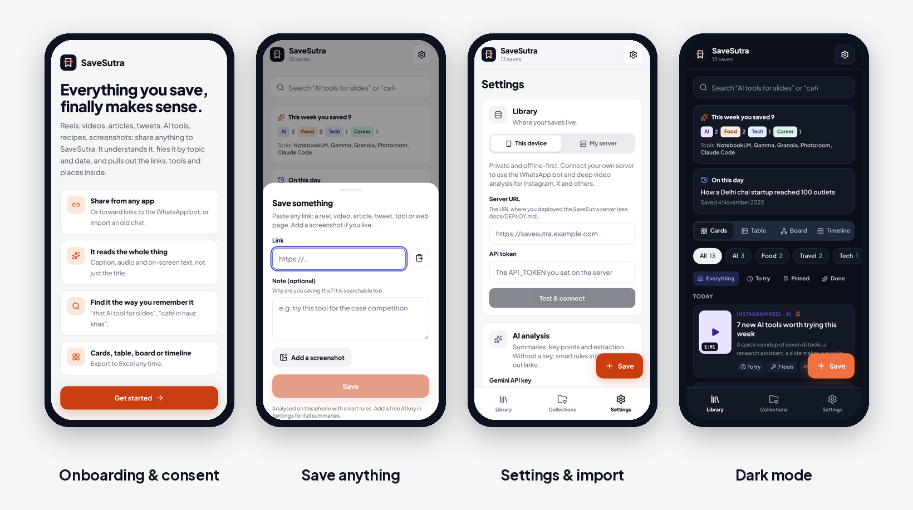
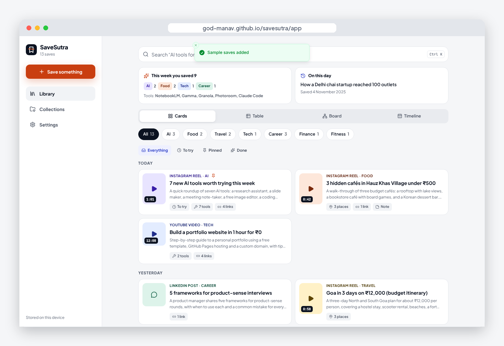
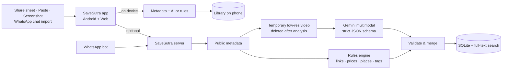

<p align="center">
  
</p>

<h3 align="center">Your AI second brain for everything you save from Instagram, YouTube, X, LinkedIn, WhatsApp and the web.</h3>

<p align="center">
  <a href="https://god-manav.github.io/savesutra/app/"><b>Open the web app</b></a> ·
  <a href="https://github.com/GOD-MANAV/savesutra/releases/latest/download/SaveSutra.apk"><b>Download for Android</b></a> ·
  <a href="docs/media/SaveSutra-demo.mp4"><b>Watch the demo</b></a> ·
  <a href="https://god-manav.github.io/savesutra/"><b>Product website</b></a> ·
  <a href="https://claude.ai/artifact/2Lgu3EdgL195GhbFWUazHm"><b>Design file</b></a>
</p>

<p align="center">
  <a href="https://github.com/GOD-MANAV/savesutra/actions/workflows/ci.yml"></a>
  <a href="https://github.com/GOD-MANAV/savesutra/actions/workflows/android.yml"></a>
  
</p>

---

## Demo video

<table>
  <tr>
    <td width="360" valign="top">
      <a href="docs/media/SaveSutra-demo.mp4"></a>
    </td>
    <td valign="top">
      <b>39 seconds, start to finish</b>
      <ol>
        <li>The problem: links sent to yourself on WhatsApp, never found again</li>
        <li>Share anything to SaveSutra</li>
        <li>It reads the caption, audio and on-screen text</li>
        <li>Every AI tool you ever saved, in one list</li>
        <li>Cards, table, board and timeline views</li>
        <li>Search the way you remember it</li>
        <li>Private by design</li>
      </ol>
      ▶ <a href="docs/media/SaveSutra-demo.mp4"><b>Watch the full-quality video (MP4)</b></a><br/>
      🌐 It also plays on the <a href="https://god-manav.github.io/savesutra/">product website</a>.
    </td>
  </tr>
</table>

---

## The problem

**People save far more content than they can ever find again.**

Every day we come across reels, videos, posts and articles worth keeping: a new AI tool, a café to try, a recipe, an interview tip, a trip plan. In India the most common way to "save" them is **WhatsApp**: forwarding the link to yourself, a family member or a one-person group. The rest end up in Instagram *Saved*, YouTube *Watch later*, screenshots and open tabs.

A few months later that pile is useless:

| Pain | What it looks like |
|---|---|
| **No context** | A chat full of `instagram.com/reel/C7x…` links. Nothing says what each one is. |
| **The value is inside the content** | The café is named at 0:20, the AI tool is shown on screen, the useful link is "in bio". The caption alone doesn't say it. |
| **Scattered across apps** | Some saves are in WhatsApp, some in Instagram, some in YouTube, some in screenshots. None of them can be searched together. |
| **Saved, never used** | No reminders, no organisation, no way to see "what did I save last week?". |

> **Where this started.** I used to send every interesting reel to my mother's WhatsApp for safekeeping. After hundreds of links, neither of us could tell which link was what.

**Problem statement:** *How might we let people save any piece of online content in one tap, from wherever they already are, and reliably find and use what's inside it later, without having to organise anything themselves?*

Existing tools only solve part of this. Bookmark managers (Raindrop, mymind) need manual sorting or don't understand video. Reel-saver apps (ReelPin, InstaSave, ClipVault) mostly cover Instagram only. WhatsApp note bots (Keepi, Crumbs) can capture links but can't structure them. *(Full analysis in the [PRD](docs/PRD.md).)*

## The solution

**SaveSutra** understands whatever you share with it. It reads the **caption, audio and on-screen text**, writes a short summary, files the save under a **topic and date**, and pulls out the **tools, places, links, prices and steps** inside. Then you can find it again in seconds, the way you remember it.

| | |
|---|---|
| 📥 **Save from anywhere** | Android share sheet, paste a link, attach a screenshot, forward to the **WhatsApp bot**, or **import an old WhatsApp chat**. Every link keeps the date it was first shared. |
| 🧠 **Understands any content** | Instagram reels and posts, YouTube videos and Shorts, X threads, LinkedIn posts, articles and blogs, screenshots, any web page. |
| 🔍 **Deep extraction** | Summary, key points, category (including a dedicated **AI** category) and tags, plus tools, places, products, books, prices, ingredients and steps, including links *said in the audio* or *shown on screen*. |
| 🗂️ **Smart collections** | *All AI tools*, *Places*, *Books*, *Recipes*, *Links found inside*. They build themselves from what's inside your saves. |
| 🧭 **Four ways to see it** | **Cards** grouped by day · a numbered **Table** with Excel/CSV export · a **Whiteboard** · a **Timeline** with a heatmap. |
| ⚡ **Search like you remember** | "AI tool for slides", "cafe hauz khas". Typos are fine. Filters: `cat:ai`, `from:youtube`, `#goa`. |
| 🔁 **Saves that get used** | Weekly digest, *On this day*, and *To try / Done / Pinned* status. |
| 🔒 **Private by design** | Your library stays on your phone by default. Clear consent, one-tap export and delete, and every AI summary is labelled. |

## Screens

<p align="center"></p>
<p align="center"></p>
<p align="center"></p>
<p align="center"></p>

## How to use SaveSutra

### 1. Get the app

| Where | How |
|---|---|
| **Android phone** | Download **[SaveSutra.apk](https://github.com/GOD-MANAV/savesutra/releases/latest/download/SaveSutra.apk)** and open it. If Android asks, allow *Install unknown apps* for your browser. |
| **Any browser** | Open **[the web app](https://god-manav.github.io/savesutra/app/)**. On Android Chrome, tap ⋮ → *Add to Home screen* to install it like an app. |

### 2. First launch
Read the short privacy notice, tick **I agree**, then choose **Explore with sample saves** (a ready-made library so you can try every feature) or **Start empty**.

### 3. Save something
- **From any app:** in Instagram, YouTube, Chrome, X, LinkedIn or WhatsApp tap **Share → SaveSutra**.
- **In the app:** tap **+ Save**, paste a link, add an optional note ("for the Goa trip"), and attach a screenshot if you like.
- **Your old WhatsApp chats:** in WhatsApp open the chat → ⋮ → *More* → *Export chat* → *Without media*. Then in SaveSutra go to **Settings → Import from WhatsApp** and pick the `.txt` file. Every link is saved with its original date.
- **On WhatsApp:** send a link to the SaveSutra bot *(needs the server, see step 8)*.

### 4. See what it found
Open any save to see its **summary**, numbered **key points**, and every **tool, place, book or product** (places open in Maps, tools open their website), plus the **links found inside** and where each came from (caption, audio or screen). Add your own note, change the category, or mark it **To try** or **Done**.

### 5. Find it later
Type in the search bar the way you remember it: *"ai tool for slides"*, *"paneer"*, *"goa itinerary"*. Narrow down with filters:

| Filter | Example | Shows |
|---|---|---|
| `cat:` | `cat:ai` | One category |
| `from:` | `from:youtube` | One platform |
| `#` | `#goa` | One tag |

### 6. Organise without organising
- Switch between **Cards · Table · Board · Timeline** at the top of the library.
- Open **Collections** for auto-built lists such as *AI tools* and *Places*.
- Use the **Timeline** heatmap to see what you saved on any day; tap a day to open it.
- Drag cards on the **Board** to arrange them for planning or brainstorming.

### 7. Export and stay in control
**Settings → Export** gives you Excel, CSV or a JSON backup. **Settings → Privacy & data** lets you read the notice again or **delete all your data** in one tap.

### 8. Optional power-ups
| Add | What you get | How |
|---|---|---|
| **Gemini AI key** (free from Google AI Studio) | Full AI summaries on your phone; YouTube videos are read in full; screenshots are understood | Settings → AI analysis |
| **Your own SaveSutra server** | Deep video analysis for Instagram, X and TikTok, and one library shared by app and bot | [Deploy guide](docs/DEPLOY.md), then Settings → Library → *My server* |
| **WhatsApp bot** | Forward links on WhatsApp; `find goa`, `more 129`, `recent`, `stop` | [WhatsApp setup](docs/WHATSAPP_SETUP.md) |

## How it works



1. **Normalise:** tracking parameters are stripped so the same reel saved twice is stored once.
2. **Read:** title, caption and author come from the public page; videos are read for audio and on-screen text.
3. **Understand:** Gemini returns a structured note (summary, key points, entities, links, category) that must match a strict schema. Without AI, a rules engine still extracts links, hashtags, prices, places and a category (with Hindi and Hinglish keywords).
4. **Index:** ranked full-text search with typo tolerance, smart collections and timeline grouping.

Details: [Architecture](docs/ARCHITECTURE.md) · [Product requirements](docs/PRD.md)

### Built with

| Layer | Technology |
|---|---|
| App | React 19, TypeScript, Vite, Tailwind CSS v4, Radix UI, TanStack Table, React Flow |
| Android | Capacitor 8 with a native share-sheet target and native HTTP |
| Storage | IndexedDB (Dexie) on device · SQLite with FTS5 full-text search on the server |
| Server | Node 22, Hono, yt-dlp, ffmpeg |
| AI | Google Gemini (multimodal video + JSON schema output) |
| Quality | 33 automated tests, CI on every push, automatic Android builds |
| Design | Designed in Claude Design, built with Claude Code |

## Privacy, security and compliance

- **India's DPDP Act 2023 and DPDP Rules 2025:** plain-language notice before consent, consent you can withdraw as easily as you gave it, export and erasure, a grievance route. ([details](docs/COMPLIANCE.md))
- **WhatsApp Business Platform rules (Jan 2026):** the bot has one purpose (saving and finding your links), replies only to your messages, and stops when you send `stop`.
- **Creators and platforms:** SaveSutra keeps notes and links, not copies. It reads public content only, never logs in to any platform, and deletes media right after analysis.
- **Security:** SSRF protection on every fetch, signed-webhook verification, rate limits, a strict content security policy, and prompts hardened against injection. ([SECURITY.md](SECURITY.md))

## Future goals

Where SaveSutra is headed next:

**Next: launch and polish**
- Publish on the **Google Play Store** with a hosted SaveSutra cloud, so the WhatsApp bot works without setting up a server.
- **iOS app** with a share extension.
- **Hindi and Hinglish interface**, and summaries in the user's own language.
- **Reminders** for *To try* saves ("You saved 3 cafés near you").

**Then: smarter retrieval**
- **Ask your saves:** answers grounded only in your own library ("Which AI tools did I save for presentations?").
- **Semantic search** with embeddings alongside keyword search.
- **Automatic resurfacing**: the right save at the right moment (travel saves before a trip, recipes on weekends).

**Later: from personal to shared**
- **Shared collections** for families and friends ("Maa's recipes", "Goa trip 2027").
- **Browser extension** and **desktop** capture.
- **Creator-friendly attribution**: every save always links back to and credits the original creator.
- **Privacy-preserving insights**: personal trends ("you saved 40 AI tools this quarter") computed on your device.

## For reviewers: run it locally

<details>
<summary>Setup instructions</summary>

```bash
git clone https://github.com/GOD-MANAV/savesutra && cd savesutra
npm install
npm run dev:web      # app on http://localhost:5173 (works offline, no keys needed)
npm test             # 33 tests across core, server and app
```

Optional server (WhatsApp bot and deep video analysis):

```bash
cp apps/server/.env.example apps/server/.env    # set API_TOKEN and GEMINI_API_KEY
npm run dev:server                              # http://localhost:8787/api/health
```

Repository layout:

```
packages/core   Shared logic: link handling, extraction, AI schema, search, collections, timeline, bot
apps/web        The app (web + Android via Capacitor)
apps/server     API, analysis pipeline, search, WhatsApp webhook
apps/site       Product website and privacy notice
docs/           PRD, architecture, compliance, deployment, WhatsApp and Android guides
```

</details>

## About

Designed and built by **Manav Yadav**: MBA, Department of Management Studies, IIT Delhi · BTech Computer Engineering, Delhi Technological University. Product management, cybersecurity and AI automation.

---

<p align="center">
  <sub><b>© 2026 Manav Yadav. All rights reserved.</b> SaveSutra is proprietary software. This repository is shared only for review; see <a href="LICENSE">LICENSE</a>.<br/>
  SaveSutra is not affiliated with Instagram, YouTube, WhatsApp, Meta or Google.</sub>
</p>
