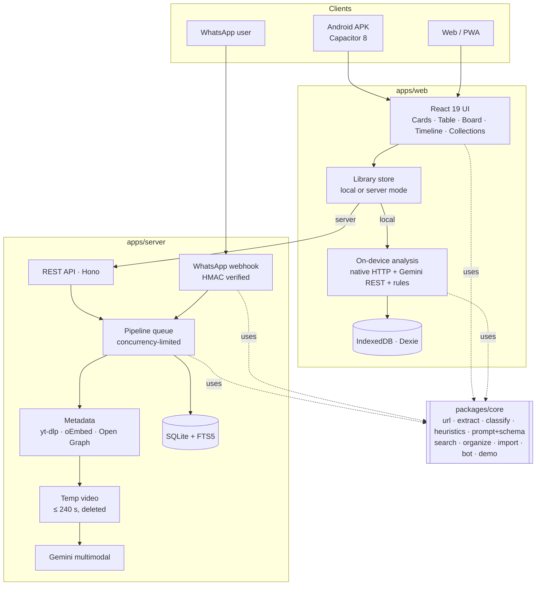

# Architecture

SaveSutra is a TypeScript monorepo. One shared core package holds all the domain logic, so the phone, the browser and the server analyse, search and format content the same way.



## packages/core

| Module | Responsibility |
|---|---|
| `url.ts` | Pull the first link from shared text, canonicalise (strip `igsh`, `si`, `utm_*`…), detect platform and kind, SSRF-safe URL check |
| `extract.ts` | Links (including bare `linktr.ee/x`), hashtags in any script, mentions, prices (₹, Rs, INR, $), list lines, places (📍, "Location:"), ingredients |
| `classify.ts` | Keyword category scoring (English + Hinglish), hashtags weighted ×2 |
| `heuristics.ts` | Full rule-based `Analysis` when there's no AI |
| `prompt.ts` | System prompt, user prompt builder, Gemini response schema, zod validation and clean-up of model JSON |
| `search.ts` | Query parser (`cat:`, `from:`, `#tag`), weighted fields, prefix and one-edit typo matching |
| `organize.ts` | Timeline grouping (day/week/month), entity index, smart collections, weekly digest, On this day, forgotten saves |
| `import.ts` | WhatsApp export parser (Android and iOS formats, 12/24-hour clocks, multi-line messages, day-first dates) |
| `bot.ts` | Command parser and WhatsApp reply templates (≤ 4096 chars) |
| `html.ts` | Open Graph / meta-tag parsing, article text extraction |
| `util.ts` | IDs, colours (WCAG AA pairs), Excel/CSV rows with formula-injection guard |

## Data model

```ts
SaveItem {
  id, seq,                    // seq = human number (#129) used by the table and the bot
  url, platform, kind, status, channel,
  meta: { title, description, author, thumbnailUrl, durationSec, … },
  analysis?: { title, summary, keyPoints[], category, tags[], entities[], links[], engine, model, confidence },
  note?, pinned?, progress?: 'inbox' | 'todo' | 'done', board?: {x, y},
  sharedAt?,                  // original date for imported links
  createdAt, updatedAt, lastOpenedAt?
}
```

## Analysis engines

| Engine | Where | Input | When |
|---|---|---|---|
| `ai-video` | Server | Low-res temp video (Instagram, X, TikTok…) or YouTube URL | Server has `GEMINI_API_KEY` |
| `ai-video` | Device | YouTube URL, or a shared screenshot | User added a Gemini key |
| `ai-text` | Both | Caption, page text, metadata | Video not available |
| `rules` | Both | Caption and page text | No key, or AI failed |

AI output always goes through `parseModelOutput` (zod) and is merged with rule-found caption links.

## Search

- **Server:** SQLite FTS5 (`unicode61 remove_diacritics`) over title, tags, entities, note, summary, body and links, ranked by `bm25` with weights 5/4/3/3/2/1/1, prefix queries.
- **Device:** `searchItems` with the same field weights, stemming, prefix and one-edit typo tolerance; needs about 60% of terms to match.

## Deployment

| Piece | Where | How |
|---|---|---|
| Website + web demo | GitHub Pages (`gh-pages`) | `.github/workflows/pages.yml` |
| Android APK | GitHub Releases (`latest`) | `.github/workflows/android.yml` |
| Server | Any Docker host (Render blueprint included) | `apps/server/Dockerfile`, `render.yaml` |
